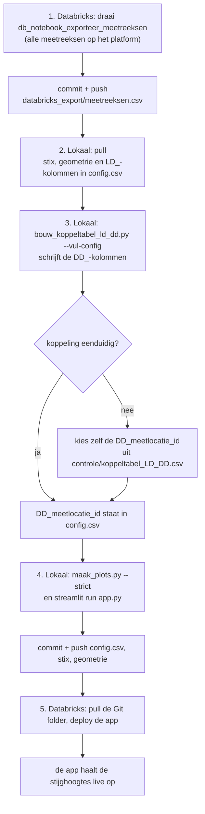

# Boxplots-pipeline

Een Streamlit-app (Databricks App) die per dwarsprofiel van een dijk de
grondopbouw, de peilbuizen en hun stijghoogtes laat zien. De stijghoogtes haalt
de app live uit het Databricks-dataplatform; de dwarsprofielen en peilbuizen
onderhouden we zelf in `input_data/`. Waterveiligheid 2030, Pilaar 3 – Analyse.

Welke Databricks-tabellen en -kolommen we gebruiken, en hoe: [DATA_CATALOG.md](DATA_CATALOG.md).

## Een nieuw dwarsprofiel toevoegen

**Eerst Databricks, dan onze eigen gegevens.** Een peilbuis die niet op het
platform staat, kunnen we niet koppelen. Daarom begint het met een export van
alle meetreeksen op het platform; die export hangt niet af van onze invoer.
Daarna vullen we lokaal de eigen gegevens in en koppelen we.

In `config.csv` zie je aan het voorvoegsel waar een kolom vandaan komt:
**`LD_`** (lokale data) vul je zelf in, **`DD_`** (Databricks-data) komt uit
Databricks en schrijft het koppelscript.



1. **Meetreeksen ophalen** (Databricks): `notebooks/db_notebook_exporteer_meetreeksen.py`,
   daarna commit en push. Alleen nodig als er sinds de vorige keer nieuwe
   putten op het platform zijn gekomen.
2. **Sleutel kiezen.** De dijkpaal uit de code van de eerste peilbuis (meestal de
   kruin): `B_BE0072+3_BUKR_GMW_PB1_F-385` → `BE_0072`. Bestaat de sleutel al,
   in welk project dan ook, zet dan de offset erachter: `BE_0072+3`.
3. **Eigen gegevens** (lokaal):
   - `input_data/D-Stability/<sleutel>.stix`
   - `input_data/dwarsprofielen/<sleutel>.csv` met kolommen `x,y` (m langs het
     profiel, m NAP), met dezelfde x-oorsprong als `LD_x_profiel`.
   - Eén rij per peilbuis in `input_data/config.csv`: alle `LD_`-kolommen (zie
     [onder](#configcsv)). Laat de `DD_`-kolommen leeg. Diepere peilbuizen in
     hetzelfde profiel krijgen dezelfde sleutel met `LD_diepte_niveau` `A` of
     `B`. Bij een nieuw project eerst een rij in `projecten.csv`.
4. **Koppelen** (lokaal):
   ```bash
   uv run python notebooks/bouw_koppeltabel_ld_dd.py --vul-config
   ```
   Vult `DD_meetlocatie_id` in waar de koppeling eenduidig is, en daarbij code,
   ligging en afstand van die meetlocatie (`DD_afstand_m` hoort een paar cm te
   zijn). De gevallen `twijfelachtig` en `meerdere kandidaten` beoordeel je
   zelf, in `input_data/controle/koppeltabel_LD_DD.csv`. Een ingevulde
   `DD_meetlocatie_id` wordt nooit overschreven.
5. **Controleren** (lokaal):
   ```bash
   uv run python notebooks/maak_plots.py --alle --strict
   uv run streamlit run app.py
   ```
6. **Deployen**: commit en push, pull de Git folder in Databricks en deploy de
   app (zie [De app](#de-app)).

## Stijghoogtes

De app haalt de stijghoogtes **bij elke nieuwe sessie** live op uit het SQL
warehouse: wie de app opent of herlaadt, ziet de laatste metingen. Binnen een
sessie blijven ze staan; de knop *Ververs stijghoogtes* haalt ze opnieuw op. Het
bijschrift zegt waar ze vandaan komen en tot welke datum ze lopen.

Lukt live ophalen niet, dan toont de app de export in
`input_data/databricks_export/`, met een waarschuwing. Die export maakt
`notebooks/db_notebook_exporteer_stijghoogtes.py`. Verversen gaat in drie
stappen: draai het notebook in de Git folder, commit en push
`input_data/databricks_export/`, en deploy de app opnieuw. `controleer_reeksen.py` werkt altijd met de export, want alleen
die heeft de uitschieters en de validatiegegevens.

**Eenmalig instellen** (in de app, *Edit → App resources*):

1. Voeg een **SQL warehouse** toe met sleutel `sql-warehouse` en recht
   *Can use*. Daarvoor heb je zelf *Can manage* op dat warehouse nodig. Zet
   in `app.yaml` de twee regels voor `DATABRICKS_WAREHOUSE_ID` aan; die geven
   het id aan de app door. **Nu staat live nog uit** (geen rechten), dus de app
   toont de export: ververs die met de drie stappen hierboven.
   Na het aanzetten is het verversen niet meer nodig voor de app.
2. Laat een beheerder de **service principal van de app** leesrechten geven op
   drie tabellen; de `GRANT`s staan in [DATA_CATALOG.md](DATA_CATALOG.md#rechten-voor-de-app).
   De app leest als die service principal, niet als de bezoeker.
3. Deploy opnieuw.

Lokaal live werken: zet `DATABRICKS_WAREHOUSE_ID` en log in met de Databricks
CLI (`databricks auth login`). Zonder die variabele gebruiken app en
`maak_plots.py` de export.

## Waar staat wat

De oude werkboeken hadden een eigen indeling. Hier staat het nu:

| wat | waar |
|---|---|
| x van een peilbuis in het profiel (`x_coordinaten_dwarsprofiel`) | `config.csv` → `LD_x_profiel`, één waarde per peilbuisrij. `workbook_lader.py` zet ze op volgorde van x weer achter elkaar. |
| teenslootpeil (`teensloot_peil`) | `config.csv` → `LD_teensloot_peil`, per dwarsprofiel; herhaald op elke rij, de eerste rij van het hoofdprofiel telt |
| maatgevend boezempeil | `projecten.csv` → `maatgevend_boezempeil_offset`: het boezempeil is de (gemiddelde) buitenwaterstand plus deze offset |
| buitenwaterstand | `projecten.csv` → `buitenwaterstand` (vast), of `buitenwaterstand_bestand` in `tijdreeksen/` (fluctuerend, het gemiddelde telt voor het boezempeil) |
| stix-verschuiving (`stix_offset_x_handmatig`) | `config.csv` → `LD_stix_offset_x` |
| filters en bovenkant peilbuis | `config.csv` → `LD_bk_filter`, `LD_ok_filter`, `LD_bk_peilbuis` (uit de inmeting) |
| grondopbouw | `D-Stability/<sleutel>.stix` |
| dijkgeometrie | `dwarsprofielen/<sleutel>.csv` |
| neerslag | `tijdreeksen/neerslag_berkhout.csv`, één reeks voor alle projecten |
| de koppeling met Databricks | `config.csv` → de `DD_`-kolommen |

## De app

```bash
uv sync
uv run streamlit run app.py
```

De landingspagina is een kaart met alle dwarsprofielen, met een kleur per
project. Grijs betekent geen stijghoogtes. Een klik op een marker (of het
zoekveld eronder) opent het profiel. De URL `?profiel=BE_0072` linkt direct naar
een profiel. In de profielplot en de tijdreeks heeft elke peilbuis dezelfde kleur.

**Databricks App.** `app.yaml` start `streamlit run app.py`. Databricks
installeert de pakketten met `uv` uit `pyproject.toml` en `uv.lock`;
`requirements.txt` is voor pip. De runtime heeft (vermoedelijk) Python 3.11,
dus `requires-python` moet 3.11 toelaten. Na een wijziging in `pyproject.toml`:
`uv lock` en `uv.lock` meecommitten.

- Deploy: *Compute → Apps → de app → Deploy*. Bron: de Git folder (de map met
  `app.yaml`), branch `development`. Fouten staan in de tab *Logs*.
- Inloggen gaat met het Entra ID-account van de workspace. Dat stelt Databricks
  in, niet de app. Wie de app mag openen staat bij *Permissions* (`CAN USE`).

## Structuur

```
app.py                     de Streamlit-app
app.yaml                   hoe Databricks de app start (en welk warehouse)
DATA_CATALOG.md            welke Databricks-tabellen en -kolommen we gebruiken
modules/                   de verwerking (gedeeld door app en notebooks)
    databricks_live.py     de live queries op het SQL warehouse
    databricks_reeksen.py  per peilbuis één meetreeks; live of uit de export
notebooks/
    db_notebook_exporteer_meetreeksen.py    Databricks: alle meetreeksen, voor de koppeling
    db_notebook_exporteer_stijghoogtes.py   Databricks: stijghoogtes als export (terugval)
    bouw_koppeltabel_ld_dd.py               lokaal: koppel peilbuizen aan meetlocaties
    controleer_reeksen.py                   lokaal: welke reeksen een controle verdienen
    maak_plots.py                           lokaal: invoercontrole + alle plots als HTML
input_data/
    config.csv             één rij per peilbuis per dwarsprofiel (LD_ zelf, DD_ uit Databricks)
    projecten.csv          met de hand: één rij per project
    D-Stability/           met de hand: <sleutel>.stix
    dwarsprofielen/        met de hand: <sleutel>.csv
    tijdreeksen/           met de hand: neerslag (Berkhout), buitenwaterstand Markermeer
    databricks_export/     gegenereerd door de db_notebooks
    controle/              gegenereerd door de controlescripts
docs/                      achtergrond over het Databricks-platform
```

## Wat deze repository doet

Per dwarsprofiel combineert `modules/profiel.py`:

- de grondopbouw uit het D-Stability-bestand (`stix_verwerker.py`);
- de dijkgeometrie en de ligging van de peilbuizen (`config.csv`, `workbook_lader.py`);
- de stijghoogtes per peilbuis uit Databricks (`databricks_reeksen.py`);
- neerslag en buitenwaterstand (`tijdreeksen/`).

Daaruit volgen een profielplot (grondopbouw, peilbuizen, gemiddelde
stijghoogtes en een freatische lijn, met een tijdslider; `analyse.py`,
`plotten.py`) en een tijdreeksplot. De boxplots, mediaan, uitschieters en
terugkeertijden staan voor de MVP uit (`ONDERDELEN_STANDAARD` in `plotten.py`).

### Per peilbuis één meetreeks

`DD_meetlocatie_id` in `config.csv` is één filter van één put op Databricks.
Heeft een meetlocatie meer meetreeksen, dan zijn dat parallelle sensoren, vaak
met een heel ander niveau. Samenvoegen kan dus niet. De keuze:

1. alleen reeksen in `m NAP` met metingen;
2. een `DD_meetreeks_id` in `config.csv` zet de keuze vast;
3. anders de reeks met de meeste metingen.

Het zijn ruwe daggemiddelden, zonder filter op `validatie_status`. Een
peilbuis zonder reeks valt uit de plot en de app zegt welke.

### config.csv

| kolom | betekent |
|---|---|
| `LD_project` | moet in `projecten.csv` staan |
| `LD_cross_section_key` | sleutel van het dwarsprofiel (`BE_0072`), uniek over alle projecten |
| `LD_diepte_niveau` | `hoofd`, of `A`/`B` voor diepere peilbuizen in hetzelfde profiel |
| `LD_peilbuis` | put + filter (`MB001PB01`) |
| `LD_projectnummer` | het onderzoeksproject van de peilbuis (`VN-86349-1`), helpt bij het koppelen |
| `LD_code` | volledige peilbuiscode: label in de plot en bron van de zone (`BUKR`, `BIT`, …) |
| `LD_x_profiel` | ligging in het profiel (m); bepaalt ook de volgorde |
| `LD_x_rd`, `LD_y_rd` | RD-coördinaten van de put; de eerste peilbuis is het kaartpunt |
| `LD_bk_peilbuis`, `LD_bk_filter`, `LD_ok_filter` | bovenkant peilbuis en filter (m NAP), uit de inmeting |
| `LD_teensloot_peil`, `LD_stix_offset_x` | per dwarsprofiel, herhaald op elke rij |
| `DD_meetlocatie_id` | de sleutel naar Databricks; leeg = niet gekoppeld. Zelf invullen mag, bij een twijfelgeval |
| `DD_meetreeks_id` | optioneel: zet de meetreeks vast (zelf invullen) |
| `DD_koppeling` | status uit de koppeltabel, zodat zichtbaar is waarom een id ontbreekt |
| `DD_meetlocatie_code`, `DD_x_rd`, `DD_y_rd` | code en ligging van de gekoppelde meetlocatie, ter controle |
| `DD_afstand_m` | afstand tussen `LD_x_rd`/`LD_y_rd` en de meetlocatie |

Een rij is uniek op `LD_project + LD_cross_section_key + LD_diepte_niveau +
LD_peilbuis`. Een peilbuisnaam alleen is geen sleutel, want `HB013PB01` bestaat
in zes projecten. Filterdieptes staan ook op Databricks, maar afgerond en soms
1,5 m anders dan de inmeting. Daarom staan ze hier als `LD_`. Meldt de log een
grote afwijking tegen de stix (RMSE > 0,5 m), zet dan `LD_stix_offset_x`.

`projecten.csv` bevat per project de vaste buitenwaterstand, de offset voor het
maatgevend boezempeil en eventueel een bestand met de fluctuerende
buitenwaterstand in `tijdreeksen/`.

### Bekende aandachtspunten

- **Zone-token `KR`** kent `analyse.py` niet (12 peilbuizen). In Schellingwoude
  staat het waar normaal `BUKR` staat, waardoor de freatische lijn daar zonder
  kruinanker wordt opgebouwd. De invoercontrole meldt deze peilbuizen.
- **13 peilbuizen in 13_6** hebben codes zonder zone-token; hun zone is onbekend.
- **`analyse.py` gebruikt twee mechanismen voor dezelfde vraag**: de zone uit de
  code en de rijvolgorde. Die kunnen elkaar tegenspreken.
- **8 dwarsprofielen hebben geen stijghoogtes** (Beemster_4_oude_raaien ×4,
  PU_0042, PU_0110, DP_0179, D14A-DP_0018); zie `controle/te_controleren.csv`.
