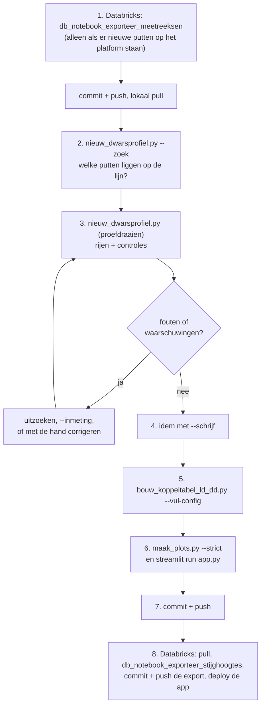

# Boxplots-pipeline

Een Streamlit-app (Databricks App) die per dwarsprofiel van een dijk de
grondopbouw, de peilbuizen en hun stijghoogtes laat zien. De stijghoogtes haalt
de app live uit het Databricks-dataplatform; de dwarsprofielen en peilbuizen
onderhouden we zelf in `input_data/`. Waterveiligheid 2030, Pilaar 3 – Analyse.

Welke Databricks-tabellen en -kolommen we gebruiken, en hoe: [DATA_CATALOG.md](DATA_CATALOG.md).

## Een nieuw dwarsprofiel toevoegen

Kort: verzamel de [ingrediënten](#wat-je-nodig-hebt), laat
`nieuw_dwarsprofiel.py` de rest invullen, koppel aan Databricks en controleer.
Met de hand kan ook ([route 2](#route-2-met-de-hand)); de regels en controles
zijn dezelfde.

### Wat je nodig hebt

Drie niveaus: project, dwarsprofiel, peilbuis. **Vet** = dit lever je zelf
aan; de rest leidt het script af.

**Per project** (eenmalig), in `projecten.csv`:

| ingrediënt | eenheid | bron |
|---|---|---|
| **projectnaam** | | eigen keuze; ook de mapnaam in `Projecten/` |
| **buitenwaterstand** | m NAP | vast getal, of `buitenwaterstand_bestand` in `tijdreeksen/` (fluctuerend) |
| **maatgevend_boezempeil_offset** | m | boezempeil = (gemiddelde) buitenwaterstand + offset |

**Per dwarsprofiel**:

| ingrediënt | eenheid | bron | komt in |
|---|---|---|---|
| **grondopbouw** | | D-Stability-model (`.stix`) | `D-Stability/<sleutel>.stix` |
| **dijkgeometrie** | x: m langs het profiel, y: m NAP | inmeting of DAM-invoer, als `x,y`-csv | `dwarsprofielen/<sleutel>.csv` |
| **profiellijn** | RD (m) | begin- en eindpunt van het dwarsprofiel in de kaart. **Het beginpunt is x = 0** van de geometrie en de stix | `profielen.csv`: `lijn_x_start_rd` … `lijn_y_eind_rd` |
| **teenslootpeil** | m NAP | peilbesluit of inmeting | `profielen.csv`: `teensloot_peil` |
| stix-verschuiving | m | alleen als de stix een andere x-oorsprong heeft (zie [controles](#wat-de-controles-betekenen)) | `profielen.csv`: `stix_offset_x` |
| sleutel | | de dijkpaal uit de code van de eerste peilbuis: `…_HH0068+30_BUKR…` → `HH_0068` | overal |

**Per peilbuis** (één rij per filter in `config.csv`):

| ingrediënt | bron | komt in |
|---|---|---|
| **naam: put + filter** (`B18PB02`) | het meetplan; `--zoek` toont wat er ligt | `LD_peilbuis` |
| **diepteniveau** | eigen keuze: `hoofd` (freatisch), `A` (zandtussenlaag), `B` (pleistoceen) | `LD_diepte_niveau` |
| bovenkant peilbuis, bovenkant en onderkant filter (m NAP) | **inmeting** als je die hebt (`--inmeting`), anders Databricks (afgerond op 0,1 m) | `LD_bk_peilbuis`, `LD_bk_filter`, `LD_ok_filter` |
| RD-coördinaten | Databricks (meetlocatie) | `LD_x_rd`, `LD_y_rd` |
| x in het profiel | projectie van RD op de profiellijn | `LD_x_profiel` |
| code met zone (`BUKR`, `BIKR`, `BIB`, `BIT`, …) | Databricks (`meetlocatie_code`) | `LD_code` |
| projectnummer | het meest voorkomende in het project | `LD_projectnummer` |
| koppeling met Databricks | `bouw_koppeltabel_ld_dd.py --vul-config` | de `DD_`-kolommen |

### Route 1: met het script



1. **Meetreeksen ophalen** (Databricks, alleen bij nieuwe putten):
   `notebooks/db_notebook_exporteer_meetreeksen.py`, dan commit en push, en
   lokaal pull.
2. **Kijken wat er op de lijn ligt**:
   ```bash
   uv run python notebooks/nieuw_dwarsprofiel.py --zoek --lijn 119552.533,518899.343,119465.158,518927.784
   ```
   Elke meetreeks binnen 25 m van de lijn, met x langs het profiel, afstand tot
   de lijn, filters en bovenkant. Kies welke peilbuizen meedoen en op welk
   diepteniveau. `HB16-PB1` heet bij ons `HB16PB01`.
3. **Proefdraaien** (schrijft niets):
   ```bash
   uv run python notebooks/nieuw_dwarsprofiel.py --project Heerhugowaard \
       --stix pad/HH0068+30_DWP003.stix --geometrie pad/geometrie.csv \
       --lijn 119552.533,518899.343,119465.158,518927.784 --teensloot -3.7 \
       --hoofd B18PB02,HB16PB01,HB17PB01,B19PB02 --diep-a B18PB01,B19PB01
   ```
   Toont de rijen en de [controles](#wat-de-controles-betekenen). Met
   `--inmeting inmeting.csv` (kolommen `peilbuis,bk_peilbuis,bk_filter,ok_filter`)
   gaan de waarden uit de inmeting voor die van Databricks.
4. **Schrijven**: dezelfde regel met `--schrijf`. Een `fout` blokkeert dat.
   `--vervang` vervangt een bestaand profiel en houdt de `DD_`-kolommen van
   peilbuizen die er al stonden.
5. **Koppelen**: `uv run python notebooks/bouw_koppeltabel_ld_dd.py --vul-config`.
   Vult `DD_meetlocatie_id` waar de koppeling eenduidig is. `twijfelachtig` en
   `meerdere kandidaten` beoordeel je zelf in `controle/koppeltabel_LD_DD.csv`.
   Let op: het script kan ook statussen in andere projecten bijwerken als
   `meetreeksen.csv` nieuwer is. Bekijk de diff voor je commit.
6. **Controleren**: `uv run python notebooks/maak_plots.py --project <project> --strict`
   en `uv run streamlit run app.py`.
7. **Commit en push**: `config.csv`, `profielen.csv`, stix, geometrie en
   `controle/koppeltabel_LD_DD.csv`.
8. **Stijghoogtes** (Databricks): pull de Git folder, draai
   `db_notebook_exporteer_stijghoogtes`, commit en push `databricks_export/`,
   en deploy de app (zie [De app](#de-app)). Tot dan staat het nieuwe profiel
   grijs op de kaart ("geen stijghoogtes"). Met live ophalen aan is deze stap
   niet nodig.

### Route 2: met de hand

Dezelfde bestanden, zelf ingevuld:

1. `D-Stability/<sleutel>.stix` en `dwarsprofielen/<sleutel>.csv` (`x,y`).
2. Een rij in `profielen.csv` (zie [kolommen](#profielencsv)).
3. Per peilbuis een rij in `config.csv` met alle `LD_`-kolommen (zie
   [kolommen](#configcsv)). Laat de `DD_`-kolommen leeg. Diepere peilbuizen
   in hetzelfde profiel krijgen dezelfde sleutel met `LD_diepte_niveau` `A`
   of `B`. Bij een nieuw project eerst een rij in `projecten.csv`.
4. Daarna stap 5 tot en met 8 van route 1.

### Regels

- **Sleutel**: de dijkpaal uit de code van de eerste peilbuis (meestal de
  kruin): `B_BE0072+3_BUKR_GMW_PB1_F-385` → `BE_0072`. Uniek over alle
  projecten; bestaat hij al, zet dan de offset erachter: `BE_0072+3`.
- **x-oorsprong**: x = 0 is het beginpunt van de profiellijn, voor de
  geometrie, de stix en `LD_x_profiel`. In Heerhugowaard ligt het beginpunt
  aan de buitenkant (boezem), zodat x oploopt van kruin naar teen; de controle
  op de zonevolgorde gaat daarvan uit.
- **Diepteniveau**: `hoofd` zijn de freatische peilbuizen; daarmee tekent de
  app de freatische lijn. `A` (zandtussenlaag) en `B` (pleistoceen) worden
  als stijghoogtelijn per laag getekend.
- **Zone**: `LD_code` moet een zone-token bevatten (`BUKR`, `BIKR`, `BIB`,
  `INSD`, `BIT`, …). Zonder token mist de freatische lijn een anker.
- **Bovenkant hoort bij de put, filters bij de sensor**: op het platform zitten
  ligging en bovenkant op de meetlocatie en de filters op de sensor. Meestal
  maakt dat niet uit; zie [valkuilen](#valkuilen) voor als het wel uitmaakt.
- **Uniek**: een rij is uniek op `LD_project + LD_cross_section_key +
  LD_diepte_niveau + LD_peilbuis`. Een peilbuisnaam alleen is geen sleutel:
  `HB013PB01` bestaat in zes projecten.

### Wat de controles betekenen

`maak_plots.py`, de app en `nieuw_dwarsprofiel.py` voeren dezelfde controles
uit (`workbook_lader.valideer` en `controleer_peilbuizen`). Een **fout** stopt
het hele project, ook in de app; een **waarschuwing** vraagt om een blik.

| melding | ernst | betekent / wat te doen |
|---|---|---|
| bovenkant filter ligt niet boven onderkant | fout | tikfout of verwisseld; controleer met de inmeting of het `F-`getal in de code (≈ midden van het filter ×100) |
| bovenkant filter ligt boven de bovenkant peilbuis | fout | kan niet. Meestal zijn putten of sensoren verwisseld; zie [valkuilen](#valkuilen) |
| x ligt buiten de geometrie | fout | verkeerde x of een te korte geometrie |
| staat niet in `profielen.csv` | fout | voeg de rij toe; zonder rij geen teenslootpeil |
| sleutel staat ook in project … / staat dubbel | fout | kies een andere sleutel, of verwijder de dubbele rij |
| bovenkant peilbuis staat … t.o.v. het maaiveld | waarschuwing | verwacht −0,5 tot +1,5 m. Klopt x, of de bovenkant? Een straatpot ligt iets onder maaiveld |
| zones staan niet in de volgorde kruin, berm, teen | waarschuwing | x of de zone in de code klopt niet, of de putten staan echt zo (leg dat vast in `opmerking`) |
| put staat … m naast de profiellijn | waarschuwing | de put ligt niet op de lijn; x is dan een projectie |
| x wijkt … af van de projectie van de RD-coördinaten | waarschuwing | x en RD spreken elkaar tegen; een van beide klopt niet |
| geen zone in de code | waarschuwing | zet een zone-token in `LD_code` |
| resterende afwijking tussen dijkprofiel en stix-maaiveld | log | de melding zegt of `stix_offset_x` helpt of dat het een hoogteverschil is |

### Valkuilen

Uit het toevoegen van Heerhugowaard (2026):

- **Namen verwisseld op Databricks.** In raai 23 (`HH_0013`) horen de filters
  van sensor B12 bij de put die als B13 te boek staat, en andersom. Dat zie
  je aan de controle "filter boven de bovenkant peilbuis" en aan het `F-`getal
  in `meetlocatie_code`. Oplossing: ligging en bovenkant van de put, filters
  van de sensor, en `DD_meetlocatie_id` met de hand. Zet de reden in
  `opmerking` in `profielen.csv`.
- **Verwisselde x in een werkboek.** In raai 13 (`HH_0195`) stonden twee
  putten in het werkboek op elkaars plek. Het script rekent x uit de
  RD-coördinaten en heeft daar geen last van; met de hand vangt de controle
  "x wijkt af van de projectie" het af, mits de profiellijn is ingevuld.
- **Putten naast de lijn.** De putten van `HH_0047` staan ca. 23 m naast de
  profiellijn. Dat mag, maar de waarschuwing blijft staan.
- **Verouderde `meetreeksen.csv`.** Een put die er niet in staat, kan het
  script niet vinden. Draai dan eerst `db_notebook_exporteer_meetreeksen`.
- **Geen stijghoogtes na het toevoegen.** De export bevat alleen peilbuizen
  die al in `config.csv` stonden; zie stap 8.

## Stijghoogtes

De app haalt de stijghoogtes **bij elke nieuwe sessie** live op uit het SQL
warehouse: wie de app opent of herlaadt, ziet de laatste metingen. Binnen een
sessie blijven ze staan; de knop *Ververs stijghoogtes* haalt ze opnieuw op. Het
bijschrift zegt waar ze vandaan komen en tot welke datum ze lopen.

Lukt live ophalen niet, dan toont de app de export in
`input_data/databricks_export/`, met een waarschuwing. Die export maakt
`notebooks/db_notebook_exporteer_stijghoogtes.py`. Verversen gaat in drie
stappen: draai het notebook in de Git folder, commit en push
`input_data/databricks_export/`, en deploy de app opnieuw. `controleer_reeksen.py` werkt altijd met de export, want alleen
die heeft de uitschieters en de validatiegegevens.

**Eenmalig instellen** (in de app, *Edit → App resources*):

1. Voeg een **SQL warehouse** toe met sleutel `sql-warehouse` en recht
   *Can use*. Daarvoor heb je zelf *Can manage* op dat warehouse nodig. Zet
   in `app.yaml` de twee regels voor `DATABRICKS_WAREHOUSE_ID` aan; die geven
   het id aan de app door. **Nu staat live nog uit** (geen rechten), dus de app
   toont de export: ververs die met de drie stappen hierboven.
   Na het aanzetten is het verversen niet meer nodig voor de app.
2. Laat een beheerder de **service principal van de app** leesrechten geven op
   drie tabellen; de `GRANT`s staan in [DATA_CATALOG.md](DATA_CATALOG.md#rechten-voor-de-app).
   De app leest als die service principal, niet als de bezoeker.
3. Deploy opnieuw.

Lokaal live werken: zet `DATABRICKS_WAREHOUSE_ID` en log in met de Databricks
CLI (`databricks auth login`). Zonder die variabele gebruiken app en
`maak_plots.py` de export.

## Invoerbestanden

| bestand | inhoud | wie vult het |
|---|---|---|
| `input_data/projecten.csv` | één rij per project | met de hand |
| `input_data/profielen.csv` | één rij per dwarsprofiel | `nieuw_dwarsprofiel.py` of met de hand |
| `input_data/config.csv` | één rij per peilbuis per dwarsprofiel; `LD_` lokaal, `DD_` uit Databricks | `nieuw_dwarsprofiel.py` (LD), `bouw_koppeltabel_ld_dd.py` (DD) |
| `input_data/D-Stability/<sleutel>.stix` | grondopbouw | `nieuw_dwarsprofiel.py` of met de hand |
| `input_data/dwarsprofielen/<sleutel>.csv` | dijkgeometrie `x,y` | `nieuw_dwarsprofiel.py` of met de hand |
| `input_data/tijdreeksen/` | neerslag (Berkhout, voor alle projecten), fluctuerende buitenwaterstand | met de hand |
| `input_data/databricks_export/` | meetreeksen en stijghoogtes van het platform | de `db_notebook_`s |
| `input_data/controle/` | koppeltabel, te controleren reeksen | de controlescripts |

De oude werkboeken kenden `x_coordinaten_dwarsprofiel` (nu `LD_x_profiel`),
`teensloot_peil` (nu in `profielen.csv`) en `stix_offset_x_handmatig` (nu
`stix_offset_x` in `profielen.csv`).

## De app

```bash
uv sync
uv run streamlit run app.py
```

De landingspagina is een kaart met alle dwarsprofielen, met een kleur per
project. Grijs betekent geen stijghoogtes. Een klik op een marker (of het
zoekveld eronder) opent het profiel. De URL `?profiel=BE_0072` linkt direct naar
een profiel. In de profielplot en de tijdreeks heeft elke peilbuis dezelfde kleur.

**Databricks App.** `app.yaml` start `streamlit run app.py`. Databricks
installeert de pakketten met `uv` uit `pyproject.toml` en `uv.lock`;
`requirements.txt` is voor pip. De runtime heeft (vermoedelijk) Python 3.11,
dus `requires-python` moet 3.11 toelaten. Na een wijziging in `pyproject.toml`:
`uv lock` en `uv.lock` meecommitten.

- Deploy: *Compute → Apps → de app → Deploy*. Bron: de Git folder (de map met
  `app.yaml`), branch `development`. Fouten staan in de tab *Logs*.
- Inloggen gaat met het Entra ID-account van de workspace. Dat stelt Databricks
  in, niet de app. Wie de app mag openen staat bij *Permissions* (`CAN USE`).

## Structuur

```
app.py                     de Streamlit-app
app.yaml                   hoe Databricks de app start (en welk warehouse)
DATA_CATALOG.md            welke Databricks-tabellen en -kolommen we gebruiken
modules/                   de verwerking (gedeeld door app en notebooks)
    workbook_lader.py      leest de invoer en doet de invoercontrole
    databricks_live.py     de live queries op het SQL warehouse
    databricks_reeksen.py  per peilbuis één meetreeks; live of uit de export
notebooks/
    db_notebook_exporteer_meetreeksen.py    Databricks: alle meetreeksen, voor de koppeling
    db_notebook_exporteer_stijghoogtes.py   Databricks: stijghoogtes als export (terugval)
    nieuw_dwarsprofiel.py                   lokaal: een dwarsprofiel uit de ingrediënten
    bouw_koppeltabel_ld_dd.py               lokaal: koppel peilbuizen aan meetlocaties
    controleer_reeksen.py                   lokaal: welke reeksen een controle verdienen
    maak_plots.py                           lokaal: invoercontrole + alle plots als HTML
input_data/
    projecten.csv          met de hand: één rij per project
    profielen.csv          één rij per dwarsprofiel (teenslootpeil, profiellijn)
    config.csv             één rij per peilbuis per dwarsprofiel (LD_ zelf, DD_ uit Databricks)
    D-Stability/           <sleutel>.stix
    dwarsprofielen/        <sleutel>.csv
    tijdreeksen/           met de hand: neerslag (Berkhout), buitenwaterstand Markermeer
    databricks_export/     gegenereerd door de db_notebooks
    controle/              gegenereerd door de controlescripts
docs/                      achtergrond over het Databricks-platform
```

## Wat deze repository doet

Per dwarsprofiel combineert `modules/profiel.py`:

- de grondopbouw uit het D-Stability-bestand (`stix_verwerker.py`);
- de dijkgeometrie en de ligging van de peilbuizen (`config.csv`,
  `profielen.csv`, `workbook_lader.py`);
- de stijghoogtes per peilbuis uit Databricks (`databricks_reeksen.py`);
- neerslag en buitenwaterstand (`tijdreeksen/`).

Daaruit volgen een profielplot (grondopbouw, peilbuizen, gemiddelde
stijghoogtes en een freatische lijn, met een tijdslider; `analyse.py`,
`plotten.py`) en een tijdreeksplot. De boxplots, mediaan, uitschieters en
terugkeertijden staan voor de MVP uit (`ONDERDELEN_STANDAARD` in `plotten.py`).

### Per peilbuis één meetreeks

`DD_meetlocatie_id` in `config.csv` is één filter van één put op Databricks.
Heeft een meetlocatie meer meetreeksen, dan zijn dat parallelle sensoren, vaak
met een heel ander niveau. Samenvoegen kan dus niet. De keuze:

1. alleen reeksen in `m NAP` met metingen;
2. een `DD_meetreeks_id` in `config.csv` zet de keuze vast;
3. anders de reeks met de meeste metingen.

Het zijn ruwe daggemiddelden, zonder filter op `validatie_status`. Een
peilbuis zonder reeks valt uit de plot en de app zegt welke.

### config.csv

| kolom | betekent |
|---|---|
| `LD_project` | moet in `projecten.csv` staan |
| `LD_cross_section_key` | sleutel van het dwarsprofiel (`BE_0072`), uniek over alle projecten |
| `LD_diepte_niveau` | `hoofd`, of `A`/`B` voor diepere peilbuizen in hetzelfde profiel |
| `LD_peilbuis` | put + filter (`MB001PB01`) |
| `LD_projectnummer` | het onderzoeksproject van de peilbuis (`VN-86349-1`), helpt bij het koppelen |
| `LD_code` | volledige peilbuiscode: label in de plot en bron van de zone (`BUKR`, `BIT`, …) |
| `LD_x_profiel` | ligging in het profiel (m vanaf het beginpunt van de profiellijn); bepaalt ook de volgorde |
| `LD_x_rd`, `LD_y_rd` | RD-coördinaten van de put; de peilbuis met de kleinste x in het hoofdprofiel is het kaartpunt |
| `LD_bk_peilbuis`, `LD_bk_filter`, `LD_ok_filter` | bovenkant peilbuis en filter (m NAP), uit de inmeting of Databricks |
| `DD_meetlocatie_id` | de sleutel naar Databricks; leeg = niet gekoppeld. Zelf invullen mag, bij een twijfelgeval |
| `DD_meetreeks_id` | optioneel: zet de meetreeks vast (zelf invullen) |
| `DD_koppeling` | status uit de koppeltabel, zodat zichtbaar is waarom een id ontbreekt |
| `DD_meetlocatie_code`, `DD_x_rd`, `DD_y_rd` | code en ligging van de gekoppelde meetlocatie, ter controle |
| `DD_afstand_m` | afstand tussen `LD_x_rd`/`LD_y_rd` en de meetlocatie |

Filterdieptes staan ook op Databricks, maar afgerond en soms 1,5 m anders dan
de inmeting. Daarom staan ze hier als `LD_` en gaat een inmeting voor.

### profielen.csv

| kolom | betekent |
|---|---|
| `project`, `cross_section_key` | zoals in `config.csv`; één rij per dwarsprofiel |
| `teensloot_peil` | teenslootpeil (m NAP); anker van de freatische lijn bij de teen |
| `stix_offset_x` | optioneel: verschuiving (m) van de geometrie t.o.v. de stix; leeg = automatisch |
| `lijn_x_start_rd`, `lijn_y_start_rd`, `lijn_x_eind_rd`, `lijn_y_eind_rd` | de profiellijn in RD; het beginpunt is x = 0. Optioneel voor oude profielen, maar zonder lijn controleert niets of x klopt |
| `opmerking` | vrije tekst: waarom een profiel afwijkt (verwisselde putten, put naast de lijn, …) |

`projecten.csv` bevat per project de vaste buitenwaterstand, de offset voor het
maatgevend boezempeil en eventueel een bestand met de fluctuerende
buitenwaterstand in `tijdreeksen/`.

### Bekende aandachtspunten

- **Zone-token `KR`** kent `analyse.py` niet (12 peilbuizen). In Schellingwoude
  staat het waar normaal `BUKR` staat, waardoor de freatische lijn daar zonder
  kruinanker wordt opgebouwd. De invoercontrole meldt deze peilbuizen.
- **13 peilbuizen in 13_6** hebben codes zonder zone-token; hun zone is onbekend.
- **`analyse.py` gebruikt twee mechanismen voor dezelfde vraag**: de zone uit de
  code en de rijvolgorde. Die kunnen elkaar tegenspreken; de controle op de
  zonevolgorde maakt dat zichtbaar.
- **8 dwarsprofielen hebben geen stijghoogtes** (Beemster_4_oude_raaien ×4,
  PU_0042, PU_0110, DP_0179, D14A-DP_0018); zie `controle/te_controleren.csv`.
  De 14 nieuwe Heerhugowaard-profielen krijgen ze na de volgende
  `db_notebook_exporteer_stijghoogtes`.
- **Profiellijn ontbreekt** voor alle profielen buiten Heerhugowaard. Wie hem
  aanvult in `profielen.csv`, krijgt de controles op x er gratis bij.
