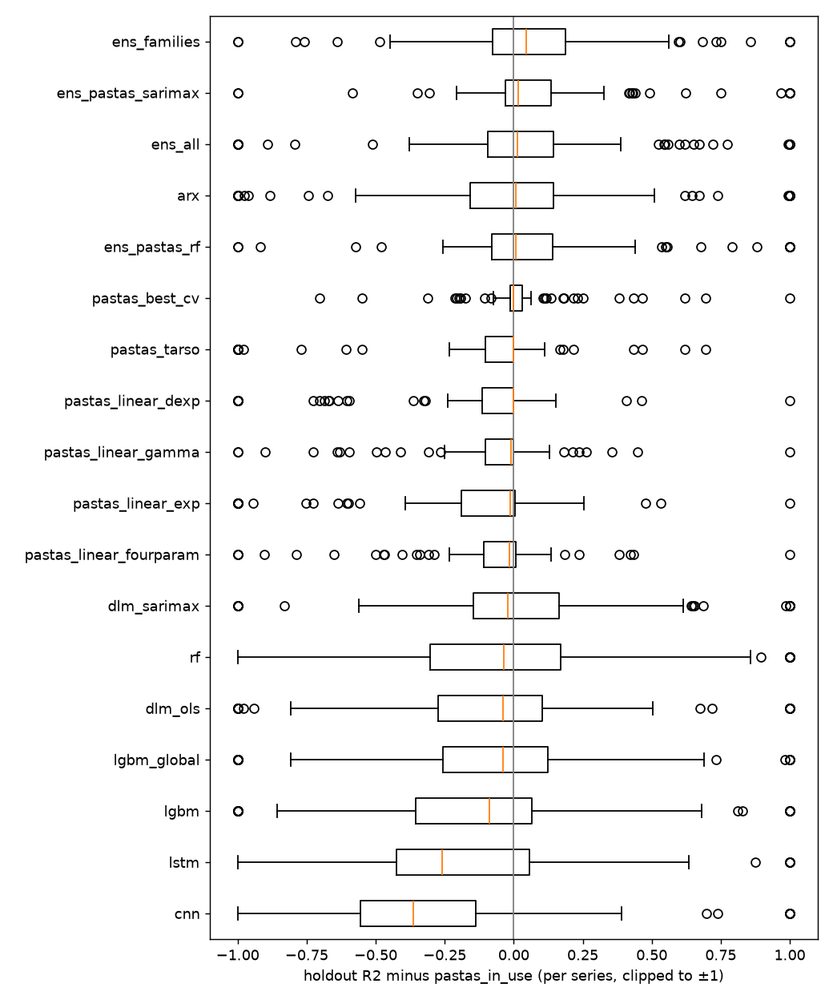

# Research: can other models beat Pastas on R² and holdout R²?

Branch `research/alt-models`. Nothing in `tarso_pipeline`, the notebooks or the dashboards changes; everything is in this folder.

## The question

The pipeline fits five Pastas models per series (Tarso and four linear-recharge transfer-function models) from KNMI 249 precipitation and Makkink evaporation. A model has to *simulate* the head from that forcing alone, because the extremes run feeds it 704 IMPREX years without any measured head.

The committed validated run (`results_export/valid_pastas`, 89 series, about two years each) scores well in-sample but much worse on unseen data:

| model in use | median | 25 % | negative |
|---|---|---|---|
| R² (in-sample) | 0.79 | 0.65 | – |
| holdout R² (fit on 70 %, simulate the last 30 %) | 0.39 | −0.04 | 25 of 89 |

So the question is whether other proven methods, using the same two inputs, give a higher R² **and** a higher holdout R².

## The candidates

| method | family | what it is |
|---|---|---|
| `pastas_<type>` | baseline | the five pipeline types, built with `tarso_pipeline.fit.build_model` and solved as the pipeline does |
| `pastas_in_use` | baseline | per series, the Pastas type the committed pipeline run selected (`model_selection.csv`); **the reference every method is compared with** |
| `pastas_best_cv` | reference | per series, the Pastas type with the best CV R². It picks using the test blocks, so it is optimistic and not a method |
| `dlm_ols` | ARX / Box-Jenkins | distributed-lag regression: net recharge P − E summed over 3–365 days, two annual Fourier pairs, a constant; least squares |
| `dlm_sarimax` | ARX / Box-Jenkins | the same regression with ARMA(p, q) errors (statsmodels `SARIMAX`, order by AIC). It simulates with the deterministic part, as Pastas drops its noise model |
| `arx` | ARX / Box-Jenkins | ARX(p) on the head itself, p ≤ 3, simulated recursively on its own output; unstable AR polynomials are rejected (Knotters & Bierkens) |
| `rf` | tree ensemble | random forest per series on P, E and P − E window sums, decayed antecedent indices and season |
| `lgbm` | tree ensemble | LightGBM per series on the same features, the number of trees chosen by early stopping |
| `lgbm_global` | tree ensemble | one LightGBM model for all series (head anomaly, the series as a category) |
| `lstm` | deep learning | one LSTM for all series over the last 365 days of P, E and season, with a series embedding; a mean of 10 seeds (Wunsch et al. 2021) |
| `cnn` | deep learning | the same set-up with a dilated 1D-CNN over 52 weekly steps (receptive field 51 weeks) |
| `ens_all` | ensemble | the mean of the simulations of every candidate above plus `pastas_in_use`, per series and fold; members fixed before any result |
| `ens_families` | ensemble | the mean of one member per family: `pastas_in_use`, `dlm_sarimax`, `rf`, `lstm`. The ARX and tree members were picked after a first pass, so this one is optimistic |
| `ens_pastas_rf` | ensemble | the mean of `pastas_in_use` and `rf` |
| `ens_pastas_sarimax` | ensemble | the mean of `pastas_in_use` and `dlm_sarimax`: no tree member, so no cap on the extremes |

The LSTM and CNN read the last 364 days as 52 weekly steps, each step carrying that week's 7 daily values as features. The networks still see daily rainfall, but the sequence is 7 times shorter, which makes 10 seeds per fold feasible on a CPU. Torch uses 4 threads, because 8 threads ran about 4 times slower on the 8-core development machine.

Ensembles that combine models from different families are a classic way to improve out-of-sample prediction (Bates & Granger 1969; Duan et al. 2007 for hydrology). They only help if the members' errors differ.

Plain SARIMA with a 365-day season is not used. It is numerically infeasible on daily data and has no forcing, so the Fourier terms play that role. One-step-ahead ARIMA forecasts are also excluded: they use measured heads, so they say nothing about an IMPREX simulation.

## The rules that keep it fair

1. **Simulation only.** No method gets a measured head after its training block. ARX runs on its own output, and the trees and networks have no head inputs at all. A test changes every head after the split and checks that the prediction stays the same (`tests/test_fairness.py`).
2. **The same data and split.** Heads come from the review stores (`scripts/run_local.py::validated_heads`) and are cleaned with `clean_head`. The forcing is `data/forcing/knmi_forcing_249.csv`. The holdout split and the R² formula are those of `tarso_pipeline.fit.holdout_r2`.
3. **The baseline is refitted in the same harness**, so every method sees the same days. Where the review stores still hold the same days as the committed run, the refitted Pastas R² equals the committed one. Where reviews have changed since then, it differs by about 0.005.
4. **Folds.**
   - `full`: in-sample R².
   - `holdout`: fit on the first 70 %, score on the rest.
   - `cv50` / `cv60`: fit on the first 50 % or 60 %, score on the next 20 %.
   - The CV R² of a series is the mean of `cv50`, `cv60` and `holdout`. A single 30 % block of a two-year series is mostly one season.
5. **Tuning only inside the training block.** Every choice uses the last 20 % of the training block: the ARX order, the forest leaf size, the boosting rounds and network early stopping.
6. **Global models stop at one calendar date.** Almost every series ends on 2026-10-12, so all test blocks fall in the same months. A model shared by all series would otherwise learn those months from the other series. Every series' training is therefore cut at the earliest split of the fold (`evaluate.global_training`).

## The decision rule

Fixed before the results. A method counts as **better** than `pastas_in_use` only if all four of these hold:

1. its median holdout R² is at least 0.05 higher;
2. the paired Wilcoxon signed-rank test on holdout R² gives p < 0.05, and it wins in more than half of the series;
3. its median CV R² is higher;
4. its median in-sample R² is not lower.

A winner would then still need an IMPREX check: simulate a few members and apply the `runaway` rule in `tarso_pipeline/selection.py`. Only after that would it be planned as a sixth model type.

## Running it

From `pastas/`. The research packages stay out of the root `uv.lock`, the same way pastas does:

```bash
UV="uv run --no-project --python 3.11 --with pastas==1.12.* --with statsmodels --with scikit-learn \
    --with lightgbm==4.6.* --with torch --with pyarrow --with scipy --with pyyaml --with tabulate"
$UV --with pytest python -m pytest research/tests -q
$UV python research/run_benchmark.py --series 5 --methods pastas,arx,trees   # a smoke run
$UV python research/run_benchmark.py --methods pastas,arx,trees --out local_runs/research/full
$UV python research/run_benchmark.py --methods lgbm_global,cnn,lstm --out local_runs/research/full
$UV python research/summarise.py local_runs/research/full
```

Or install the extra: `pip install -e ".[pastas,research,dev]"`. LightGBM is pinned to 4.6 because 4.7 crashes in its C library on Windows.

A rerun into the same folder skips methods it has already scored there. Results go to `local_runs/` (git-ignored). The summary below is copied from `summary.md`.

## Results (run of 2026-11-18, 89 validated series)

The full table is [results/summary.md](results/summary.md), and the scores per series, method and fold are in [results/scores.csv](results/scores.csv). Rerunning gives identical scores (largest difference 4e-16).

| method | R² in-sample | holdout R² median | holdout R² 25 % | holdout < 0 | CV R² median | wins vs in use | p (Wilcoxon) |
|---|---|---|---|---|---|---|---|
| **pastas_in_use** (baseline) | 0.78 | **0.41** | −0.09 | 23 / 89 | 0.05 | – | – |
| ens_pastas_rf | 0.90 | 0.46 | **0.14** | **15** | 0.25 | 47 / 89 | 0.07 |
| **ens_pastas_sarimax** | 0.81 | 0.45 | **0.16** | **17** | 0.24 | **53 / 89** | **0.003** |
| ens_families | 0.86 | 0.44 | **0.22** | **15** | 0.27 | 46 / 84 | **0.035** |
| ens_all | 0.86 | 0.43 | 0.19 | 16 | 0.19 | 45 / 84 | 0.23 |
| dlm_sarimax | 0.80 | 0.44 | 0.03 | 21 | −0.02 | 42 / 89 | 0.49 |
| rf | 0.97 | 0.44 | 0.01 | 22 | 0.04 | 34 / 89 | 0.91 |
| arx | 0.84 | 0.40 | −0.16 | 26 | −0.22 | 45 / 89 | 0.60 |
| lgbm_global | 0.84 | 0.38 | 0.03 | 20 | 0.13 | 32 / 84 | 0.96 |
| dlm_ols | 0.85 | 0.35 | −0.15 | 30 | −0.14 | 41 / 89 | 0.92 |
| lgbm | 0.96 | 0.30 | −0.15 | 27 | 0.09 | 32 / 89 | 1.00 |
| lstm | 0.69 | 0.18 | −0.42 | 30 | −0.10 | 24 / 84 | 1.00 |
| cnn | 0.66 | 0.10 | −0.31 | 32 | −0.39 | 14 / 84 | 1.00 |

The global models have 84 series instead of 89. Five series begin so late that the common calendar cutoff leaves them fewer than 30 training days.



### What this says

1. **No method meets the decision rule, but one comes close.**
   - `ens_pastas_sarimax` is the mean of the Pastas model in use and the SARIMAX transfer function. It wins in 53 of 89 series, the paired test is clearly significant (p = 0.003), and its CV R² (0.24 against 0.05) and in-sample R² are higher. It fails only the size criterion: its median holdout R² is 0.04 higher, where the rule asks for 0.05.
   - `ens_pastas_rf` gains 0.05 in the median, but its test is p = 0.07.
   - `ens_families` is significant (p = 0.035), but gains only 0.03.
   - All three were put together after the first pass, so they are optimistic. Only `ens_all` was fixed beforehand.
2. **No single alternative beats Pastas.**
   - The ARX/SARIMAX models and the random forest have about the same median holdout R² as Pastas. They lose in more than half of the series.
   - The trees fit the calibration years almost perfectly (R² 0.96–0.97) but predict unseen years no better: classic overfitting on about two years of data.
   - The global LSTM and CNN are clearly worse. Even pooled over 84 series, the training is too short for a network to learn a reliable response to the weather, all the more after the strict calendar cutoff. This matches Collenteur et al. (2024): with little data, lumped transfer-function models are hard to beat.
3. **Ensembles mainly remove the bad cases, not the typical one.**
   - Averaging Pastas with a model from another family hardly moves the median. It does lift the worst quarter from −0.09 to 0.14–0.22, and it cuts the series with a negative holdout R² from 23 to 15.
   - The members make different mistakes, so the average rarely collapses. This is the most promising direction.
4. **The in-sample R² of an ensemble is inflated** by the forest's near-perfect training fit. That is why the decision rests on the holdout and CV scores.
5. **A Tarso holdout can collapse.** Since `holdout_r2` gives Tarso the drainage-level range of the training part only (the beta-0.1 fix), a test period wetter or drier than that range can blow it up: R² −144 on one series. The committed results predate that fix.

### What would be needed before anything goes into the pipeline

- **Confirm the ensemble on data it was not chosen on:** the unvalidated series on Databricks, or the validated series again once they have another year. Fix the members before looking (for example `pastas_in_use` + `rf`).
- **An IMPREX check.**
  - A forest cannot predict outside the heads it was trained on, so averaging with it would damp the 704-year extremes. That counts against using it for return levels, even though it never runs away.
  - `ens_pastas_sarimax` has no such cap, so it is the one to take to IMPREX. Its SARIMAX member is linear in the forcing, so check it against the `runaway` rule on the dry and wet tails.
- **If it holds,** add the ensemble as an option to `fit.py`/`simulate.py`, with the `runaway` rule applied to the average. That needs a separate plan.
