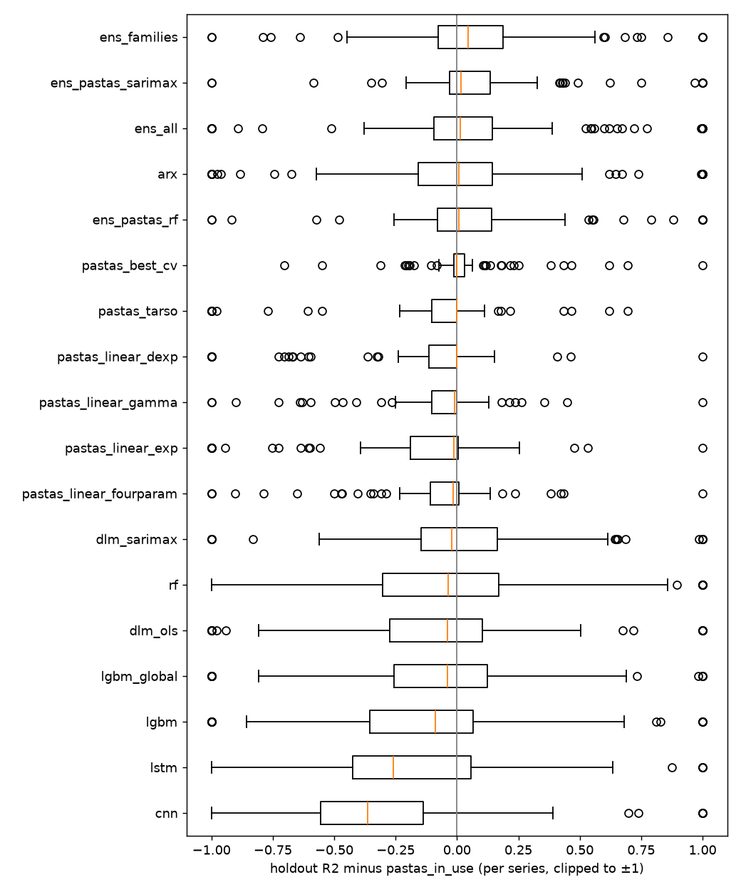

# Benchmark full

89 series. Baseline `pastas_in_use`: the Pastas type the pipeline selected per series, refitted in this harness on the same data. `pastas_best_cv` picks the best Pastas type per series with the test blocks: an optimistic reference, not a method. `ens_*` average the members' simulations (see `ENSEMBLES` in summarise.py; `ens_families` was put together after a first pass, so it is optimistic).

| method                  |   n |   r2_median |   r2_holdout_median |   r2_holdout_q25 |   holdout_negative |   r2_cv_median |   d_holdout_median |   wins |   paired |   p_wilcoxon | better   |
|:------------------------|----:|------------:|--------------------:|-----------------:|-------------------:|---------------:|-------------------:|-------:|---------:|-------------:|:---------|
| ens_pastas_rf           |  89 |       0.902 |               0.459 |            0.141 |                 15 |          0.254 |              0.006 |     47 |       89 |        0.073 | False    |
| ens_pastas_sarimax      |  89 |       0.808 |               0.449 |            0.161 |                 17 |          0.235 |              0.016 |     53 |       89 |        0.003 | False    |
| dlm_sarimax             |  89 |       0.804 |               0.44  |            0.032 |                 21 |         -0.021 |             -0.022 |     42 |       89 |        0.488 | False    |
| rf                      |  89 |       0.968 |               0.439 |            0.012 |                 22 |          0.037 |             -0.035 |     34 |       89 |        0.908 | False    |
| ens_families            |  84 |       0.857 |               0.436 |            0.222 |                 15 |          0.27  |              0.046 |     46 |       84 |        0.035 | False    |
| ens_all                 |  84 |       0.863 |               0.427 |            0.194 |                 16 |          0.185 |              0.015 |     45 |       84 |        0.231 | False    |
| pastas_best_cv          |  89 |       0.778 |               0.411 |           -0.006 |                 23 |          0.27  |              0     |     38 |       89 |        0.106 | False    |
| pastas_in_use           |  89 |       0.778 |               0.407 |           -0.087 |                 23 |          0.051 |              0     |      0 |       89 |      nan     | False    |
| arx                     |  89 |       0.842 |               0.397 |           -0.156 |                 26 |         -0.216 |              0.007 |     45 |       89 |        0.604 | False    |
| lgbm_global             |  84 |       0.841 |               0.376 |            0.032 |                 20 |          0.126 |             -0.039 |     32 |       84 |        0.958 | False    |
| pastas_linear_dexp      |  89 |       0.747 |               0.356 |           -0.234 |                 28 |         -0.006 |              0     |     20 |       89 |        1     | False    |
| pastas_linear_exp       |  89 |       0.727 |               0.356 |           -0.304 |                 31 |          0.112 |             -0.013 |     25 |       89 |        1     | False    |
| dlm_ols                 |  89 |       0.847 |               0.348 |           -0.145 |                 30 |         -0.142 |             -0.038 |     41 |       89 |        0.923 | False    |
| pastas_tarso            |  89 |       0.786 |               0.345 |           -0.385 |                 30 |          0.035 |              0     |     23 |       89 |        0.997 | False    |
| pastas_linear_gamma     |  89 |       0.769 |               0.341 |           -0.174 |                 26 |          0.077 |             -0.01  |     19 |       89 |        1     | False    |
| pastas_linear_fourparam |  89 |       0.772 |               0.337 |           -0.105 |                 28 |          0.104 |             -0.016 |     30 |       89 |        1     | False    |
| lgbm                    |  89 |       0.955 |               0.304 |           -0.148 |                 27 |          0.085 |             -0.089 |     32 |       89 |        0.997 | False    |
| lstm                    |  84 |       0.691 |               0.181 |           -0.415 |                 30 |         -0.099 |             -0.259 |     24 |       84 |        1     | False    |
| cnn                     |  84 |       0.655 |               0.097 |           -0.314 |                 32 |         -0.385 |             -0.364 |     14 |       84 |        1     | False    |

Failed fits (method, fold):

none